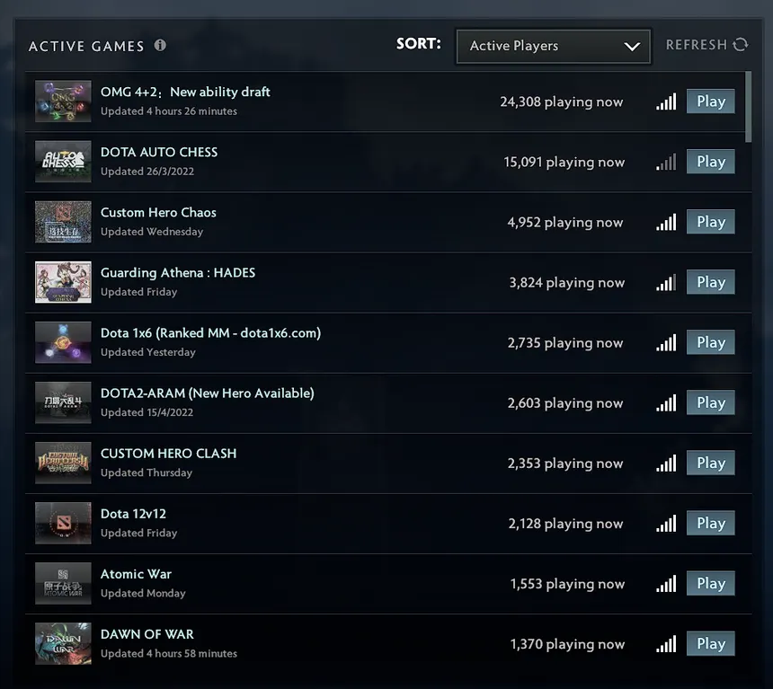
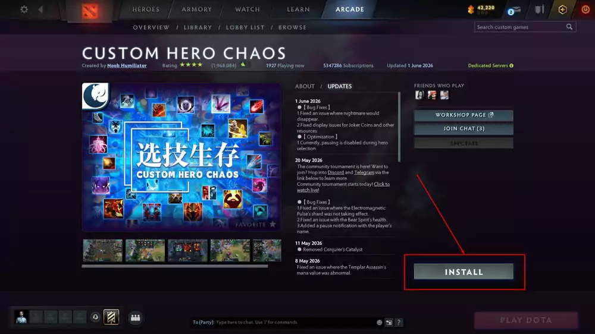

# Market research — 2026-10-14

Snapshot of the Dota 2 custom game landscape, the official Ability Draft, and player feedback, taken
before building the draft. Numbers change; re-run the queries below to compare.

## Key takeaways

1. **Ability-building modes lead the Arcade.** "OMG 4+2: New ability draft" was the most played custom
   game (24,308 players now); Legends of Dota has 1.3M subscribers. The niche has demand.
2. **"Turbo + official Ability Draft" is uncontested.** Players ask for Turbo Ability Draft on the
   Steam forums and Valve has not built it. Existing mods in the space are small (keymil's 22k
   subscribers, "10v10 Ability Draft" 13k) and none follows the official rules.
3. **Official Ability Draft changed recently**: hero drafting since 7.39, facets removed in 7.41. Mods
   that copied Valve's data by hand fall behind; reading data at runtime is a real advantage.
4. **Top Arcade titles are short and say what the mode is**; no top-10 game puts a version in its
   title, because the Arcade shows "Updated <time>" and an UPDATES section.
5. **No paid backends**: Valve banned monetization in Aug 2023 and modes with server costs died
   (Ability Arena). Valve can pull Workshop items without notice (Overthrow 3.0, Jul 2026).

## Arcade: active games

Screenshot from the Dota client, "Active Games" sorted by active players:

| # | Game | Playing now | Last update shown |
| --- | --- | ---: | --- |
| 1 | OMG 4+2: New ability draft | 24,308 | 4 hours ago |
| 2 | DOTA AUTO CHESS | 15,091 | 26/3/2022 |
| 3 | Custom Hero Chaos | 4,952 | Wednesday |
| 4 | Guarding Athena : HADES | 3,824 | Friday |
| 5 | Dota 1x6 (Ranked MM - dota1x6.com) | 2,735 | Yesterday |
| 6 | DOTA2-ARAM (New Hero Available) | 2,603 | 15/4/2022 |
| 7 | CUSTOM HERO CLASH | 2,353 | Thursday |
| 8 | Dota 12v12 | 2,128 | Friday |
| 9 | Atomic War | 1,553 | Monday |
| 10 | DAWN OF WAR | 1,370 | 4 hours ago |

Game page example (Custom Hero Chaos): rating, players now, subscriptions, last update, an
ABOUT / UPDATES panel with dated notes, screenshots, Workshop page and chat buttons:

## Workshop: subscribers

Source: Dota 2 Workshop browse (Custom Game tag, sorted by total unique subscribers, first 90) and
Steam's public `ISteamRemoteStorage/GetPublishedFileDetails` API. Subscribers are current
subscriptions, not active players.

Name patterns among the top: short names that say what the mode is (Overthrow, Pudge Wars, Dota
Run), "Dota" + concept (Dota IMBA, Dota 10v10), explanatory subtitles ("Pudge Wars (1 hook = 1
kill)"), and occasionally a patch number (Legends of Dota 7.41). "Ability Draft Reborn" is taken.

### Top 90 custom games by current subscribers

| # | Title | Subscribers | Lifetime subscribers | Last update |
| --- | --- | ---: | ---: | --- |
| 1 | [DOTA AUTO CHESS](https://steamcommunity.com/sharedfiles/filedetails/?id=1613886175) | 10,171,590 | 11,776,624 | 2026-10-12 |
| 2 | [Overthrow](https://steamcommunity.com/sharedfiles/filedetails/?id=455312245) | 10,129,976 | 11,660,572 | 2018-05-15 |
| 3 | [Pudge Wars (1 hook = 1 kill)](https://steamcommunity.com/sharedfiles/filedetails/?id=470524658) | 6,780,556 | 7,868,770 | 2026-10-06 |
| 4 | [Dota 10v10](https://steamcommunity.com/sharedfiles/filedetails/?id=498108721) | 6,080,624 | 7,232,182 | 2017-11-08 |
| 5 | [Dota IMBA](https://steamcommunity.com/sharedfiles/filedetails/?id=440115357) | 5,451,825 | 6,746,703 | 2023-09-27 |
| 6 | [Custom Hero Chaos:VG-Fast Match](https://steamcommunity.com/sharedfiles/filedetails/?id=1999002498) | 5,355,373 | 6,835,283 | 2026-09-30 |
| 7 | [Pudge Wars [7.29 Fixed]](https://steamcommunity.com/sharedfiles/filedetails/?id=296831818) | 5,130,481 | 6,279,007 | 2021-05-21 |
| 8 | [Dota Run](https://steamcommunity.com/sharedfiles/filedetails/?id=469890148) | 4,649,706 | 5,639,126 | 2026-09-29 |
| 9 | [Skillshot Wars](https://steamcommunity.com/sharedfiles/filedetails/?id=297809214) | 4,026,814 | 4,868,228 | 2017-02-04 |
| 10 | [Overthrow 2.0](https://steamcommunity.com/sharedfiles/filedetails/?id=1517661692) | 3,964,528 | 4,910,995 | 2022-05-31 |
| 11 | [WTF+ (OLD)](https://steamcommunity.com/sharedfiles/filedetails/?id=476601122) | 3,770,903 | 4,529,140 | 2018-04-04 |
| 12 | [Epic Boss Fight (Discontinued)](https://steamcommunity.com/sharedfiles/filedetails/?id=305278898) | 3,553,150 | 4,542,775 | 2018-02-23 |
| 13 | [Angel Arena Reborn - Global Update](https://steamcommunity.com/sharedfiles/filedetails/?id=500020226) | 3,290,465 | 4,235,188 | 2022-09-06 |
| 14 | [Life In Arena](https://steamcommunity.com/sharedfiles/filedetails/?id=407750024) | 2,744,886 | 3,637,510 | 2026-08-15 |
| 15 | [OVERTHROW 3.0 SERVERS +](https://steamcommunity.com/sharedfiles/filedetails/?id=2760533777) | 2,529,485 | 2,978,275 | 2026-10-02 |
| 16 | [Colosseum](https://steamcommunity.com/sharedfiles/filedetails/?id=543155633) | 2,439,697 | 3,198,833 | 2017-11-08 |
| 17 | [Dota 2 Duel 1v1](https://steamcommunity.com/sharedfiles/filedetails/?id=480002123) | 2,417,484 | 2,803,101 | 2015-07-18 |
| 18 | [Spin TD](https://steamcommunity.com/sharedfiles/filedetails/?id=497032202) | 2,408,211 | 3,187,216 | 2022-01-04 |
| 19 | [Battle of Mirkwood - Battle Royale](https://steamcommunity.com/sharedfiles/filedetails/?id=1092484716) | 2,290,081 | 3,157,978 | 2024-01-13 |
| 20 | [Together We Stand (NEW GAME DARWIN'S ISLAND 2)](https://steamcommunity.com/sharedfiles/filedetails/?id=323196916) | 2,278,983 | 3,153,795 | 2022-03-15 |
| 21 | [Element TD](https://steamcommunity.com/sharedfiles/filedetails/?id=626780182) | 2,224,833 | 2,917,724 | 2026-10-12 |
| 22 | [Dota 12v12 SERVERS +](https://steamcommunity.com/sharedfiles/filedetails/?id=1576297063) | 2,179,489 | 2,800,075 | 2026-09-27 |
| 23 | [DOTA OMG 4+2](https://steamcommunity.com/sharedfiles/filedetails/?id=2748923393) | 2,093,510 | 2,906,886 | 2026-10-14 |
| 24 | [DAWN OF WAR](https://steamcommunity.com/sharedfiles/filedetails/?id=1733136384) | 1,970,039 | 2,689,671 | 2026-10-14 |
| 25 | [GemTD](https://steamcommunity.com/sharedfiles/filedetails/?id=474619917) | 1,853,248 | 2,629,807 | 2026-10-14 |
| 26 | [CUSTOM HERO CLASH](https://steamcommunity.com/sharedfiles/filedetails/?id=2141071809) | 1,825,578 | 2,517,807 | 2026-10-07 |
| 27 | [Dota Tutorial](https://steamcommunity.com/sharedfiles/filedetails/?id=2411152014) | 1,811,801 | 2,244,513 | 2022-11-24 |
| 28 | [Hardcore Ninja](https://steamcommunity.com/sharedfiles/filedetails/?id=368833491) | 1,786,321 | 2,253,579 | 2026-09-20 |
| 29 | [无限螺旋2 - 无尽黄昏](https://steamcommunity.com/sharedfiles/filedetails/?id=518202526) | 1,726,868 | 2,480,246 | 2026-10-14 |
| 30 | [BIRZHA MEMOV](https://steamcommunity.com/sharedfiles/filedetails/?id=932631669) | 1,665,419 | 2,375,074 | 2026-10-05 |
| 31 | [Attack On Hero](https://steamcommunity.com/sharedfiles/filedetails/?id=523905569) | 1,557,941 | 2,103,023 | 2018-01-07 |
| 32 | [Guarding Athena](https://steamcommunity.com/sharedfiles/filedetails/?id=530286038) | 1,500,320 | 2,134,878 | 2026-03-25 |
| 33 | [Auto Gladiators:VG—Fast Match](https://steamcommunity.com/sharedfiles/filedetails/?id=3147450491) | 1,494,712 | 1,961,097 | 2026-10-09 |
| 34 | [DOTA 1X6 - SERVERS WORKING](https://steamcommunity.com/sharedfiles/filedetails/?id=2836965027) | 1,465,911 | 1,781,856 | 2026-10-14 |
| 35 | [Dota 2 Horde Mode](https://steamcommunity.com/sharedfiles/filedetails/?id=472597026) | 1,447,657 | 2,005,455 | 2019-02-16 |
| 36 | [Legion TD: Reborn (Outdated)](https://steamcommunity.com/sharedfiles/filedetails/?id=541930328) | 1,420,930 | 1,877,335 | 2022-11-09 |
| 37 | [Roshpit Champions RPG 4.1](https://steamcommunity.com/sharedfiles/filedetails/?id=469311655) | 1,399,723 | 2,169,316 | 2025-12-15 |
| 38 | [Legends of Dota 7.41 (Pick your skills, draft abilities, play with bots, make a custom hero, use any ability on any hero)](https://steamcommunity.com/sharedfiles/filedetails/?id=296590332) | 1,338,233 | 1,770,669 | 2026-04-30 |
| 39 | [Petri Reborn](https://steamcommunity.com/sharedfiles/filedetails/?id=483720948) | 1,335,785 | 1,876,690 | 2026-07-28 |
| 40 | [training polygon](https://steamcommunity.com/sharedfiles/filedetails/?id=813598504) | 1,107,121 | 1,424,965 | 2026-10-06 |
| 41 | [Wraith Night: Expansion](https://steamcommunity.com/sharedfiles/filedetails/?id=472824777) | 1,055,114 | 1,565,031 | 2015-11-16 |
| 42 | [Angel Arena Black Star](https://steamcommunity.com/sharedfiles/filedetails/?id=699441891) | 1,036,518 | 1,449,874 | 2019-12-29 |
| 43 | [AOW5 (Local)](https://steamcommunity.com/sharedfiles/filedetails/?id=1331857008) | 1,027,580 | 1,531,903 | 2026-10-11 |
| 44 | [Roshan Defense . Legacy](https://steamcommunity.com/sharedfiles/filedetails/?id=1104335651) | 1,004,476 | 1,476,209 | 2026-06-08 |
| 45 | [[仙侠] 荒神罪 - 东皇杀劫](https://steamcommunity.com/sharedfiles/filedetails/?id=520323982) | 1,002,421 | 1,605,912 | 2026-03-25 |
| 46 | [SF WARS](https://steamcommunity.com/sharedfiles/filedetails/?id=481195453) | 997,157 | 1,332,860 | 2015-09-12 |
| 47 | [For The King: Beacon Fire](https://steamcommunity.com/sharedfiles/filedetails/?id=517544352) | 987,866 | 1,431,407 | 2021-05-07 |
| 48 | [Rubick Wars](https://steamcommunity.com/sharedfiles/filedetails/?id=304273658) | 979,493 | 1,311,772 | 2026-10-11 |
| 49 | [Troll & Elves 2](https://steamcommunity.com/sharedfiles/filedetails/?id=687495832) | 975,340 | 1,327,952 | 2019-06-09 |
| 50 | [X Hero Siege 4.0: Reborn](https://steamcommunity.com/sharedfiles/filedetails/?id=536682348) | 961,592 | 1,336,821 | 2026-09-12 |
| 51 | [Boss Survival Adventure](https://steamcommunity.com/sharedfiles/filedetails/?id=1571786267) | 916,895 | 1,344,806 | 2026-10-07 |
| 52 | [Invoker Wars Reborn](https://steamcommunity.com/sharedfiles/filedetails/?id=297182961) | 909,676 | 1,168,135 | 2018-11-30 |
| 53 | [Metaverse Re: Chapter 00 [ Memories ]](https://steamcommunity.com/sharedfiles/filedetails/?id=600881584) | 872,636 | 1,319,769 | 2022-09-20 |
| 54 | [Crumbling Island Arena](https://steamcommunity.com/sharedfiles/filedetails/?id=473718711) | 862,454 | 1,210,616 | 2024-09-23 |
| 55 | [Memes Reborn](https://steamcommunity.com/sharedfiles/filedetails/?id=763126489) | 859,039 | 1,230,285 | 2019-08-30 |
| 56 | [WTF+](https://steamcommunity.com/sharedfiles/filedetails/?id=1579522476) | 856,181 | 1,083,106 | 2025-05-03 |
| 57 | [Green TD Reborn](https://steamcommunity.com/sharedfiles/filedetails/?id=470189528) | 832,853 | 1,158,536 | 2026-04-01 |
| 58 | [Custom Hero Survival 7.00](https://steamcommunity.com/sharedfiles/filedetails/?id=302247405) | 786,519 | 1,135,363 | 2018-08-06 |
| 59 | [[仙侠] 荒神罪 - 蜀山传](https://steamcommunity.com/sharedfiles/filedetails/?id=866471631) | 741,208 | 1,186,763 | 2026-09-23 |
| 60 | [Troll vs Elves 4](https://steamcommunity.com/sharedfiles/filedetails/?id=2027812233) | 722,411 | 1,051,861 | 2026-10-03 |
| 61 | [Snipers Duel](https://steamcommunity.com/sharedfiles/filedetails/?id=468785151) | 718,959 | 964,238 | 2018-12-09 |
| 62 | [DOTA AUTO CHESS - TEST](https://steamcommunity.com/sharedfiles/filedetails/?id=835235955) | 697,119 | 935,972 | 2026-10-14 |
| 63 | [Grand Magus](https://steamcommunity.com/sharedfiles/filedetails/?id=465591548) | 665,616 | 906,701 | 2018-12-05 |
| 64 | [Dota Global Skillshots 7.05](https://steamcommunity.com/sharedfiles/filedetails/?id=466843568) | 651,694 | 923,900 | 2017-04-09 |
| 65 | [Warlock Brawl](https://steamcommunity.com/sharedfiles/filedetails/?id=296662770) | 644,142 | 883,632 | 2022-01-15 |
| 66 | [(WE MOVED)Naruto Wars Reborn 1.0.7d](https://steamcommunity.com/sharedfiles/filedetails/?id=532265484) | 641,050 | 910,776 | 2021-05-22 |
| 67 | [aram test](https://steamcommunity.com/sharedfiles/filedetails/?id=2582703634) | 629,876 | 975,811 | 2024-01-26 |
| 68 | [Battle of Characters](https://steamcommunity.com/sharedfiles/filedetails/?id=511860561) | 624,012 | 901,717 | 2015-11-01 |
| 69 | [Pudge Wars Classic](https://steamcommunity.com/sharedfiles/filedetails/?id=322254016) | 620,917 | 801,982 | 2016-02-28 |
| 70 | [Random Farm TD [Localhost +]](https://steamcommunity.com/sharedfiles/filedetails/?id=2052179257) | 607,373 | 855,811 | 2026-09-18 |
| 71 | [Zhu Xian V0.8.2](https://steamcommunity.com/sharedfiles/filedetails/?id=651103612) | 588,479 | 963,831 | 2026-09-30 |
| 72 | [One Shot One Kill V0.7C](https://steamcommunity.com/sharedfiles/filedetails/?id=543923614) | 552,769 | 806,490 | 2017-02-07 |
| 73 | [Brodota！](https://steamcommunity.com/sharedfiles/filedetails/?id=3013631558) | 552,301 | 898,652 | 2026-09-20 |
| 74 | [Legion TD](https://steamcommunity.com/sharedfiles/filedetails/?id=2776958541) | 542,067 | 717,614 | 2026-09-12 |
| 75 | [Pure Reflex v.0147](https://steamcommunity.com/sharedfiles/filedetails/?id=575540979) | 531,169 | 743,768 | 2023-08-27 |
| 76 | [Save the Keeper](https://steamcommunity.com/sharedfiles/filedetails/?id=943694786) | 529,755 | 794,870 | 2026-02-25 |
| 77 | [[防守] King Wen's legend-Hero v0.9](https://steamcommunity.com/sharedfiles/filedetails/?id=552972841) | 525,177 | 847,778 | 2016-12-18 |
| 78 | [Epic Boss Fight Reborn](https://steamcommunity.com/sharedfiles/filedetails/?id=1844502841) | 522,711 | 789,043 | 2026-04-07 |
| 79 | [NavalWarfare v1.2.9](https://steamcommunity.com/sharedfiles/filedetails/?id=524239685) | 508,841 | 826,120 | 2026-07-17 |
| 80 | [Roshan defense. Reborn](https://steamcommunity.com/sharedfiles/filedetails/?id=2468947502) | 489,137 | 782,084 | 2026-09-30 |
| 81 | [Dota LevelUp-NEW GAME!!](https://steamcommunity.com/sharedfiles/filedetails/?id=3464793431) | 485,645 | 684,630 | 2026-09-22 |
| 82 | [WOD: ARENA — NEW GAME](https://steamcommunity.com/sharedfiles/filedetails/?id=2880603428) | 469,249 | 649,714 | 2026-10-12 |
| 83 | [Last Survivors](https://steamcommunity.com/sharedfiles/filedetails/?id=3025298643) | 463,839 | 722,234 | 2026-10-10 |
| 84 | [Banjoball Alpha](https://steamcommunity.com/sharedfiles/filedetails/?id=669883818) | 463,454 | 632,558 | 2021-01-03 |
| 85 | [WTF （S14）](https://steamcommunity.com/sharedfiles/filedetails/?id=2955192878) | 462,978 | 659,088 | 2026-10-09 |
| 86 | [Touhou Avatar Dream Battle](https://steamcommunity.com/sharedfiles/filedetails/?id=1332364041) | 452,073 | 719,959 | 2026-09-20 |
| 87 | [Invasion of zombies FT](https://steamcommunity.com/sharedfiles/filedetails/?id=524035937) | 431,809 | 645,358 | 2019-04-02 |
| 88 | [Squirrel World RPG ( Ogre Magi )](https://steamcommunity.com/sharedfiles/filedetails/?id=2326145404) | 416,503 | 724,236 | 2026-03-28 |
| 89 | [Kill Boss And Win](https://steamcommunity.com/sharedfiles/filedetails/?id=1436504119) | 397,060 | 640,900 | 2026-09-12 |
| 90 | [RABBITS vs. SHEEP](https://steamcommunity.com/sharedfiles/filedetails/?id=2603318713) | 383,819 | 639,591 | 2023-09-23 |

### Ability-building, draft, turbo and mid-lane modes

| # | Title | Subscribers | Lifetime subscribers | Last update |
| --- | --- | ---: | ---: | --- |
| 1 | [Dota 2 Duel 1v1](https://steamcommunity.com/sharedfiles/filedetails/?id=480002123) | 2,417,484 | 2,803,101 | 2015-07-18 |
| 2 | [DOTA OMG 4+2](https://steamcommunity.com/sharedfiles/filedetails/?id=2748923393) | 2,093,510 | 2,906,886 | 2026-10-14 |
| 3 | [Legends of Dota 7.41 (Pick your skills, draft abilities, play with bots, make a custom hero, use any ability on any hero)](https://steamcommunity.com/sharedfiles/filedetails/?id=296590332) | 1,338,233 | 1,770,669 | 2026-04-30 |
| 4 | [1x1 draft cup](https://steamcommunity.com/sharedfiles/filedetails/?id=3699421763) | 112,179 | 124,474 | 2026-09-16 |
| 5 | [Ability Draft Reborn](https://steamcommunity.com/sharedfiles/filedetails/?id=540804156) | 102,109 | 145,580 | 2016-02-11 |
| 6 | [1x1 Solomid Duels](https://steamcommunity.com/sharedfiles/filedetails/?id=3172554197) | 75,451 | 92,987 | 2026-05-08 |
| 7 | [Custom Hero OMG](https://steamcommunity.com/sharedfiles/filedetails/?id=2726323091) | 30,124 | 49,691 | 2022-04-04 |
| 8 | [ABILITY DRAFT TURBO 10vs10](https://steamcommunity.com/sharedfiles/filedetails/?id=3007022276) | 22,113 | 28,014 | 2026-04-06 |
| 9 | [WTF Legends / SERVERS+ AI OMG](https://steamcommunity.com/sharedfiles/filedetails/?id=3562058512) | 19,207 | 23,771 | 2026-10-12 |
| 10 | [TURBO 1X1](https://steamcommunity.com/sharedfiles/filedetails/?id=3747760574) | 17,420 | 19,021 | 2026-07-10 |
| 11 | [10v10 Ability Draft](https://steamcommunity.com/sharedfiles/filedetails/?id=2961207780) | 13,014 | 23,211 | 2023-05-13 |
| 12 | [Red Bull R1v1r Runes](https://steamcommunity.com/sharedfiles/filedetails/?id=1570316591) | 9,060 | 13,435 | 2021-07-11 |
| 13 | [Dota 10v10 - Turbo](https://steamcommunity.com/sharedfiles/filedetails/?id=1352809977) | 6,176 | 8,254 | 2018-04-05 |
| 14 | [Dota 2 but its Ability NO Draft (Dotico)](https://steamcommunity.com/sharedfiles/filedetails/?id=1689784841) | 6,042 | 10,067 | 2019-04-15 |
| 15 | [OMG4+2比赛专用](https://steamcommunity.com/sharedfiles/filedetails/?id=2809924495) | 4,878 | 8,402 | 2025-09-02 |
| 16 | [⚔️ Overthrow: Ability Draft Custom ⚔️](https://steamcommunity.com/sharedfiles/filedetails/?id=3478732678) | 4,805 | 6,341 | 2026-10-13 |
| 17 | [Turbo+](https://steamcommunity.com/sharedfiles/filedetails/?id=1203125526) | 4,197 | 5,757 | 2020-05-25 |
| 18 | [Tutum TURBO / 12v12 /](https://steamcommunity.com/sharedfiles/filedetails/?id=3670125578) | 4,112 | 5,187 | 2026-09-16 |
| 19 | [solo lobby (dev)](https://steamcommunity.com/sharedfiles/filedetails/?id=3167223702) | 3,866 | 5,590 | 2025-08-22 |
| 20 | [Ability Without Draft](https://steamcommunity.com/sharedfiles/filedetails/?id=2033660107) | 3,523 | 6,249 | 2020-04-02 |
| 21 | [dota vs turbo](https://steamcommunity.com/sharedfiles/filedetails/?id=3313672492) | 2,968 | 4,517 | 2024-08-21 |
| 22 | [Card Draft](https://steamcommunity.com/sharedfiles/filedetails/?id=550752792) | 2,557 | 4,610 | 2015-11-15 |
| 23 | [Incomplete - Turbo Duplicate Heroes](https://steamcommunity.com/sharedfiles/filedetails/?id=3464183266) | 2,147 | 2,759 | 2025-04-17 |
| 24 | [DOTA2 TURBO PLUS (WTF+6)](https://steamcommunity.com/sharedfiles/filedetails/?id=2374352387) | 1,940 | 2,869 | 2024-01-04 |
| 25 | [12v12 Turbo](https://steamcommunity.com/sharedfiles/filedetails/?id=2063939049) | 1,928 | 2,693 | 2020-05-10 |
| 26 | [Single Draft but Turbo Maybe Bi-Turbo](https://steamcommunity.com/sharedfiles/filedetails/?id=2938671407) | 1,893 | 2,917 | 2023-03-21 |
| 27 | [Dota 2 but it's Dota Turbo](https://steamcommunity.com/sharedfiles/filedetails/?id=1728026395) | 1,446 | 2,610 | 2019-04-30 |
| 28 | [DraftAbility_TD](https://steamcommunity.com/sharedfiles/filedetails/?id=2250532804) | 1,136 | 3,037 | 2023-03-21 |
| 29 | [dota no ability](https://steamcommunity.com/sharedfiles/filedetails/?id=3461924874) | 1,091 | 1,751 | 2025-04-17 |
| 30 | [AGHS LAB 2 TURBO EXTREME](https://steamcommunity.com/sharedfiles/filedetails/?id=2776946369) | 988 | 2,268 | 2023-06-13 |
| 31 | [1vs1 turbo](https://steamcommunity.com/sharedfiles/filedetails/?id=3664775853) | 977 | 1,135 | 2026-02-13 |
| 32 | [Multicast 8X Turbo](https://steamcommunity.com/sharedfiles/filedetails/?id=2933214677) | 709 | 1,395 | 2023-02-16 |
| 33 | [Dota Turbo with Memes](https://steamcommunity.com/sharedfiles/filedetails/?id=1989891923) | 649 | 1,112 | 2020-02-15 |
| 34 | [Tutum TURBO / 5v5 / Captains Mode](https://steamcommunity.com/sharedfiles/filedetails/?id=3800492044) | 349 | 424 | 2026-09-20 |

## keymil's "ABILITY DRAFT TURBO 10vs10"

- Workshop id 3007022276, created 2023-07-19, last update 2026-04-06 (frequent updates in March and
  April 2026).
- 22,111 current subscribers, 28,009 lifetime (2026-10-14).
- Discord "Keymillo Arcade Dota2": 2,495 members, 621 online (public invite API, 2026-10-14).
- Monetized through Patreon, Boosty and PayPal; the description forbids re-uploads.
- Features (from its description): 10v10; draft 3 regular + 1 ultimate, then innate + extra facet,
  then talents; Turbo with -25% cooldowns and mana costs, 2x gold and XP, -50% respawn and buyback
  cooldown; ability upgrades every 4 minutes; Golden Treasures every 6 minutes.
- Its description still mentions facets, which Dota removed in 7.41.
- Not in the Arcade top 10 by active players.

## Official Ability Draft

- Rules before 7.39 (Dota 2 Wiki): random hero, pool of 10 + 2 extra heroes (48 regular + 12
  ultimates), snake order over 4 phases, 60 s planning, 7 s per pick, 5 s breaks, 30 s strategy,
  6:35 in total. Details in [DESIGN.md](../DESIGN.md#official-ability-draft-reference).
- 7.39 (May 2025): the base hero is drafted as one of the picks; mass ability interaction fixes;
  minigames while queuing.
- 7.41: facets removed from the game (client patch notes).
- Valve data: `AbilityDraftAbilities` per hero, `AbilityDraftExtraAbilities` and
  `AbilityDraftUltShardAbility` per ability; Dota 7.41f, build 6958 had 1951 abilities and 127 hero
  draft pools.

## Player feedback

Pain points with official Ability Draft:

- Long queues and few players; Valve added minigames to the queue in 7.39.
- Slow to start; Turbo players will not wait ("kind of a dead mode").
- Broken combos at low levels and abilities that do not work outside their hero lead to abandons.
- No way to tell during the draft whether abilities stack; tooltips are written for normal Dota.
- Some abilities need a partner (Arcane Orb without Essence Flux, Eclipse without Lucent Beam).
- Hard for new players; a bad hero/ability fit can make a hero unplayable.

Wishes:

- Turbo Ability Draft (Valve reportedly will not build it).
- Synergy and win-rate help: players install overlays such as Ability Draft Plus (top picks, synergy
  highlights, strong and trap combos, "best third ability", win-rate tooltips) because the draft
  pool is not exposed to Game State Integration.
- Visible Scepter/Shard upgrades (the official UI hides them behind Ctrl+Alt).
- A surrender option for hopeless games (divisive).

## Similar modes

- **Custom Hero Chaos** (top Arcade mode): 16 random skills per pick, hero rerolls, 1 hero ban and
  1 skill ban per player, comeback tokens, betting on duels, rating.
- **Legends of Dota / Redux**: ability and hero bans, blocked "troll combos" (e.g. Rearm + Thundergod's
  Wrath), point-budget balance mode, an "all allowed" map; still updated (7.41 in its title).
- **OMG 4+2**: the most played ability-draft mode today; worth studying its draft screen and pacing.
- **Overthrow**: kill target or time limit, contested center for gold/XP, item deliveries favor
  teams that are behind, leader bounty.
- **Ability Arena** (Ability Draft + Auto Chess): shut down after the 2023 monetization ban because of
  server costs.
- Other modes in the niche: "10v10 Ability Draft" (13k), "Overthrow: Ability Draft Custom" (4.8k),
  "TURBO 1X1" (17k), "1x1 Solomid Duels" (75k), "1x1 draft cup" (112k).

## Arcade context and risks

- Dota's daily online peak on June 2 was 584k, the lowest since 2013 (escorenews).
- Arcade lobbies suffer from bots that never ready up.
- No monetization of any kind since Aug 17, 2023; the Workshop license is non-commercial.
- Valve can pull Workshop items without notice (Overthrow 3.0, July 2026, restored days later).

## Sources

- Dota 2 Workshop browse, Custom Game tag: https://steamcommunity.com/workshop/browse/?appid=570&browsesort=totaluniquesubscribers&section=readytouseitems&requiredtags%5B%5D=Custom+Game
- Steam API `GetPublishedFileDetails` (no key required).
- Dota 2 Wiki, Ability Draft and Game modes (via the MediaWiki API): https://dota2.fandom.com/wiki/Ability_Draft
- 7.39 Ability Draft changes: https://esports.gg/news/dota-2/5-things-we-love-about-dota-2-patch-7-39-ability-draft/,
  https://blast.tv/dota/news/dota-2-patch-739-spring-forward-gameplay-update
- Dota client files (SteamTracking mirror, build 6958): https://github.com/SteamTracking/GameTracking-Dota2
- Turbo Ability Draft requests: https://steamcommunity.com/app/570/discussions/0/594017161232565803
- Ability Draft guide (pain points): https://billiondollarcompany.substack.com/p/the-ultimate-ability-draft-guide
- Ability Draft Plus: https://github.com/Tiarin-Hino/ability-draft-plus
- Custom Hero Chaos: https://billiondollarcompany.substack.com/p/custom-hero-chaos-the-biggest-game
- Legends of Dota Redux: https://mintlify.wiki/DarkoniusXNG/Legends-of-Dota-Redux/gameplay/ability-selection
- Ability Arena: https://www.gosugamers.net/dota2/features/61115-interview-with-sunsfan-about-ability-arena
- Overthrow guides: https://www.dotafire.com/dota-2/guide/how-not-to-throw-in-overthrow-a-detailed-guide-21879
- Overthrow 3.0 removal: https://esports.ru/dota-2/news/overthrow30-vnezapno-ischezla-iz-dota2/
- Monetization ban: https://www.pcgamesinsider.biz/news/73959/report-valve-cracking-down-on-monetisation-of-dota-workshop-games/
- Dota online peak: https://escorenews.com/en/dota-2/news/78531-dota-2-daily-online-peak-shows-record-low-since-2013
